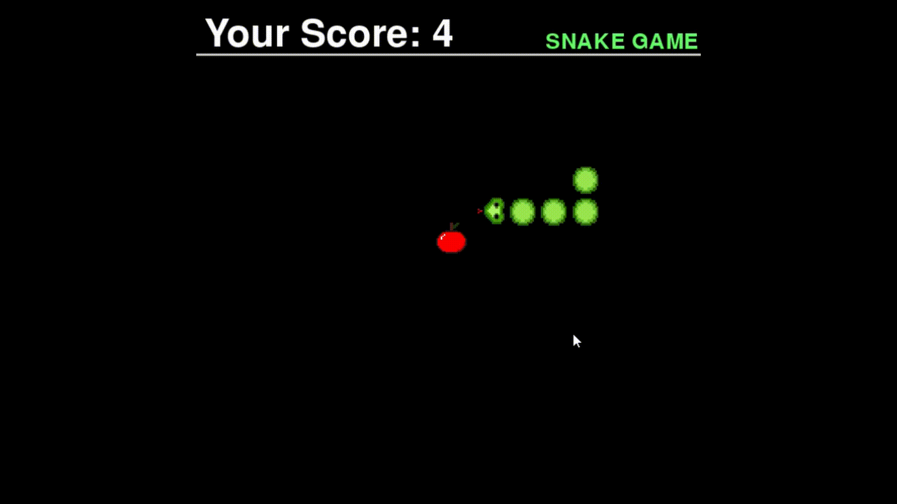

# ByteBite
the nostalgic snake game with modern power up elements and mechanics built with python and pygame-ce with different speeds and powerups
## Features
**Multiple speed levels** choose your prefered speed from the main menu

**Powerups**
there are various types of powerups 
- **x2 score:** a temporary bonus that doubles the score you gain from collecting apples
- **Shield:** saves you from a crash once while active
## Controls
### Main menu
- **UP & DOWN:** change speed level
- **ENTER:** start the game
### In-Game 
- **UP, DOWN, LEFT & RIGHT:** Move
- **ESC:** exit to main menu
## Sneak Peek of the game

## How to Install
### Option 1:- direct install
***Go to releases, download a stable version and enjoy***
### Option 2:- playing in your IDE 
**1- install Python 3.10+:**

```bash
winget install -e --id Python.Python.3.10 --scope machine
```

**2- install pygame-ce:**

```bash
py -m pip install pygame-ce
```

**3- Clone the Repository:**

```bash
git clone https://github.com/mohamedh151109-alt/ByteBite.git
cd ByteBite
```